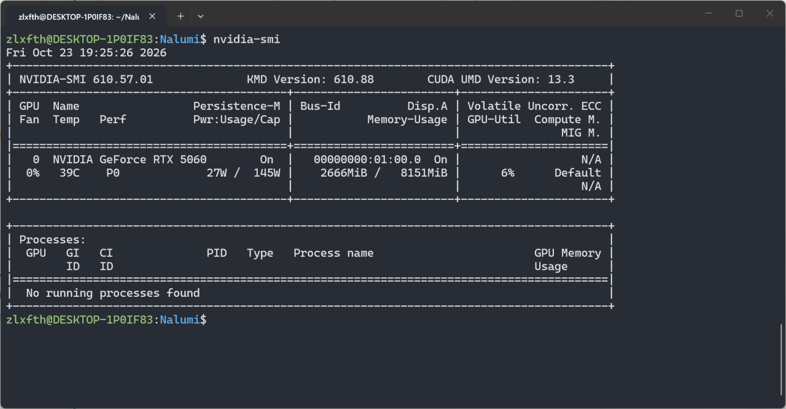
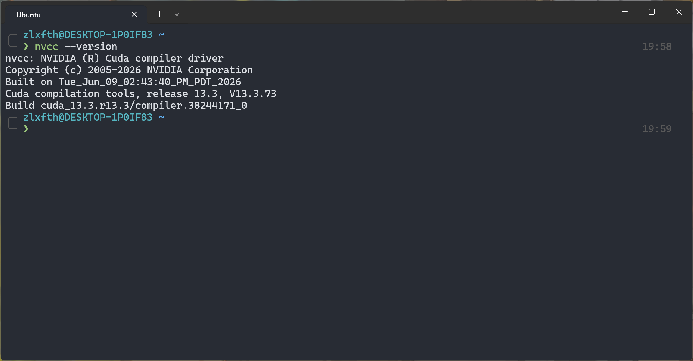

## 环境

9600x + 32GB + 5060 8GB





## 

cuda

nvcc


Grid（网格） -> Block（线程块） -> Thread（线程）

Thread 是一个干活的人，Block 是一个干活小组，组内可以协作（？），Grid 是整个团队

`__global__`

`__device__`

```
gridDim.x: 
blockDim.x: 
```

## SM

Streaming Multiprocessor（流式多处理器），是 GPU 内部集成调度、计算和片上存储资源的硬件模块。

SM 是 GPU 的模块化设计，设计一块 GPU 时复用 SM 的设计，提高 SM 数量，可以直接提高算力。

## Warp

Warp（线程束），硬件意义上的划分最小单位，按照 `threadIdx` $32$ 个连续 Thread 一组自动划分，Thread 来自同一个 Block，所以一个 Block 的最后一个 Warp 可能会有 lane 不参与执行。

Lane（通道），理解为 Thread 在 Warp 内的位置编号。

为什么要设计 Warp？这些线程干一样的活，均摊发射指令的时间成本。

### Warp Scheduler

一个 Warp Scheduler 每个 Cycle 会选择一个已经就绪的 Warp 选择一个发射执行指令。现代架构一个 SM 通常有多个 WS（通常 4 个），这种设计可以避免在一个 Warp 上面等待，也可以同时启动多个已就绪 Warp。

WS 在 Warp 间切换是零开销的（zero-overhead context switch），是说切换不需要像 CPU 那样保存/恢复。

```
Warp A 发射内存读取指令 → 等待数据返回（~400 cycles）
Warp Scheduler 切换到 Warp B → 执行计算指令
切换到 Warp C → 执行计算指令
...
Warp A 数据就绪 → 重新调度执行
```

一个 Warp 的执行 Pipeline：


加法举例，Fetch 是拿到 ADD 指令，Decode 是识别出要做加法，Issue 可以理解为把任务交给干活的人，Execute 就是干活，Write Back 是上交干活成果。

特征：同步执行（Warp 里面所有 Thread）/状态独立（寄存器文件 & 程序计数器（程序走到哪里了））

### Warp Divergence

Divergence 差异

WD 指同一个 Warp 

## SIMT & SIMD

Single Instruction, Multiple Threads

Single Instruction, Multiple Data

| 📊 对比维度 | SIMD（如 AVX-512）            | SIMT（CUDA Warp）                |
| ---------- | ----------------------------- | -------------------------------- |
| 编程视角   | 程序员显式操作向量寄存器      | 每个线程拥有独立的程序计数器和栈 |
| 分支处理   | 使用掩码（mask）跳过特定 lane | 硬件自动序列化分支路径           |
| 寻址灵活性 | 所有 lane 通常访问连续数据    | 每个线程可独立寻址               |
| 编程难度   | 需手动向量化                  | 标量代码自动在 32 线程上并行     |

这个表格要举例理解，比如说现在要进行两个数组对应位置相加

```
a[] = {1, 2, 3, 4, ...}
b[] = {2, 2, 2, 2, ...}
// a * b
c[] = {3, 4, 5, 6, ...}
```

SIMD 的想法是把，把一批标量打包成向量统一操作，比如这个例子 4 个 4 个打包，变成 `(1, 2, 3, 4)` 和 `(2, 2, 2, 2)` 的向量加法。遇到不同元素需要不同处理的情况，使用掩码控制哪些 lane 参与操作，或选择各 lane 的输出结果。

SIMT，参考 Cuda Kernel 的写法，它的思路是人只需要从单个线程的视角关注怎么编写即可，即 `c[i] = a[i] + b[i]`， 硬件自动把线程划分成 Wrap。

## Reference

[AI Infra Guide](https://caomaolufei.github.io/AIInfraGuide/)

